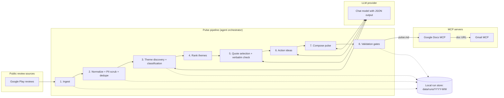
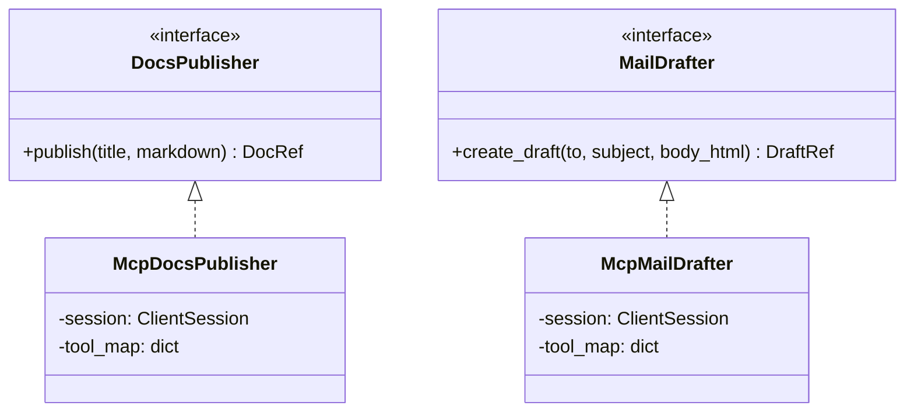
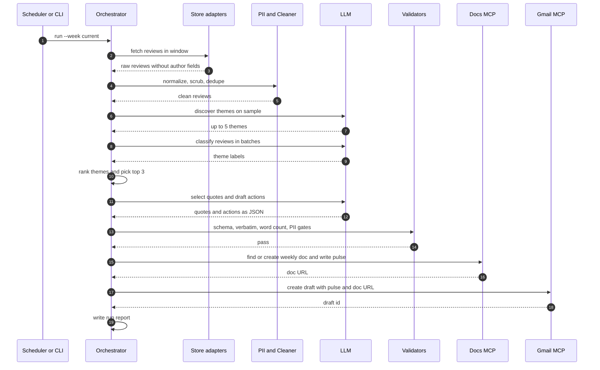

# Architecture: Groww Weekly App Review Pulse

> Source of requirements: [problemStatement.md](./problemStatement.md)

---

## 1. Purpose & Scope

Turn public Groww app reviews (**Google Play only for now**; Apple App Store is deferred) into a **one-page weekly pulse** that holds:

- **Top 3 themes** (taken from at most 5 clustered themes)
- **3 verbatim, anonymous user quotes**
- **3 concrete action ideas**

The pulse is published to **Google Docs**, and a **Gmail draft** containing it (or a link to it) is created. Both go through **MCP servers**, not hand-written Google API / OAuth code.

### In scope
- Pulling public Google Play reviews from roughly the last 8–12 weeks
- Cleaning, de-duplicating, and removing PII
- Theme clustering (≤5), summarising, picking quotes, generating actions
- Writing the pulse to Google Docs and creating a Gmail draft through MCP
- Manual and scheduled (weekly) runs

### Out of scope
- **Apple App Store reviews** (deferred; the ingestion layer keeps a source-adapter interface so it can be added later)
- Scraping behind logins, or any automation that breaks store ToS
- Sending emails automatically (we only create a **draft**)
- Real-time dashboards, replying to reviews, sentiment over many years

---

## 2. Requirements Traceability

| # | Requirement (from problem statement) | Where it is met |
|---|---|---|
| R1 | Import reviews from the last 8–12 weeks | §5.1 Ingestion, `REVIEW_WINDOW_WEEKS` |
| R2 | Public exports only, no ToS-violating scraping | §5.1 source adapters, §9 guardrails |
| R3 | At most 5 themes | §5.3 Theming, schema `maxItems: 5` |
| R4 | Pulse highlights top 3 themes | §5.4 Ranking |
| R5 | 3 real, verbatim quotes | §5.5 Quote selection + verbatim validator |
| R6 | 3 action ideas grounded in themes | §5.6 Action generation |
| R7 | ≤250 words, scannable | §5.7 Composer + word-count gate |
| R8 | No PII in any artifact | §5.2 PII scrubber + §5.8 final PII gate |
| R9 | Publish to Google Docs via MCP | §6.2 Docs MCP |
| R10 | Gmail draft to self/alias via MCP | §6.3 Gmail MCP |

---

## 3. High-Level Architecture



**Design principles**
1. **Deterministic where possible, LLM only where needed.** Fetching, filtering, PII scrubbing, ranking, counting, and validation are plain code. The LLM only does the language work: naming themes, classifying reviews, picking quotes, writing actions.
2. **Trust but verify.** Every LLM output is checked against a JSON schema and by code (quotes must match the source text exactly, word count, PII).
3. **MCP-first integrations.** Google Workspace access goes only through MCP tool calls. The agent never stores Google credentials.
4. **Reproducible runs.** Each stage writes its output to disk, so a run can be inspected, replayed, or resumed from any stage.

---

## 4. Technology Choices

| Concern | Choice | Rationale |
|---|---|---|
| Language | Python 3.11+ | Good scraping and LLM libraries; official MCP Python SDK |
| Play Store reviews | `google-play-scraper` (Python) | Reads public review data, no login needed |
| LLM | Any chat model that supports structured JSON output (e.g. Gemini / Claude / GPT) behind a thin `LLMClient` interface | Lets you switch providers |
| Validation | `pydantic` models + JSON Schema | Strict contracts for LLM outputs |
| MCP client | `mcp` Python SDK (stdio transport) | Standard way to call MCP tools |
| Config | `.env` + `config.yaml` | Keeps secrets apart from settings |
| Scheduling | cron / GitHub Actions / launchd, running `python -m pulse run` weekly | Simple, outside the app |
| Tests | `pytest` with recorded fixtures | Offline, deterministic tests |

> [!NOTE]
> **Apple App Store is deferred.** When added later, the plan is Apple's public RSS JSON feed (`itunes.apple.com/{cc}/rss/customerreviews/...`), which returns only about 500 recent reviews per country, so the run report would need to state any coverage gap.

---

## 5. Pipeline Stages (Detailed)

### 5.1 Ingestion

**Input:** `config.yaml` (app IDs, countries, window)
**Output:** `data/runs/<run_id>/01_raw_reviews.jsonl`

| Source | Identifier | Method | Notes |
|---|---|---|---|
| Google Play | `com.nextbillion.groww` | `reviews()` sorted by `NEWEST`, paged with continuation tokens, `lang=en`, `country=in` | Stop paging once `at < window_start` |

**Rules**
- Window: `window_start = run_date - REVIEW_WINDOW_WEEKS` (default 12, minimum 8).
- Rate limiting: a polite delay between pages (e.g. 1–2 s) and exponential backoff on 429/5xx errors.
- Hard cap: `MAX_REVIEWS_PER_SOURCE` (default 20,000) to bound cost.
- Raw author names / IDs are **never saved**. They are dropped inside the adapter, before anything is written to disk.

### 5.2 Normalize, PII Scrub, De-duplicate

**Output:** `02_clean_reviews.jsonl`

**Normalized review schema**

```json
{
  "id": "gp_7f3a…",          // sha256(source + original_review_id), truncated
  "source": "google_play",    // "app_store" reserved for later
  "rating": 1,                // 1–5
  "title": "string|null",     // null for Google Play (kept for a future App Store adapter)
  "text": "string",           // PII-scrubbed body
  "date": "2026-09-28",
  "app_version": "string|null",
  "week": "2026-W39"
}
```

**PII scrubber** (regex + rules, applied to `title` and `text`):

| Pattern | Replacement |
|---|---|
| Email addresses | `[email]` |
| Phone numbers (Indian +91 / 10-digit formats) | `[phone]` |
| PAN (`[A-Z]{5}[0-9]{4}[A-Z]`) | `[id]` |
| Aadhaar-like 12-digit groups | `[id]` |
| Bank account / long digit runs (≥9 digits) | `[number]` |
| UPI handles (`name@bank`) | `[upi]` |
| URLs | `[link]` |
| @mentions / reviewer names quoted in text | `[name]` |

**Filtering**
- Keep only reviews with **more than 8 words** (`limits.min_review_words: 9`). Empty and shorter reviews (e.g. "good", "nice app") go to a count only, not to theming.
- De-duplicate by normalized text hash (spam and copy-paste reviews).
- Emoji: reviews containing any emoji are counted and excluded.
- Language: English only. Other scripts and romanized Hindi (Hinglish, detected by ≥2 Hindi function words) are counted and excluded (shown in the run report).

### 5.3 Theme Discovery & Classification (LLM)

A two-pass approach keeps the themes stable and the cost bounded:

**Pass A — Discovery** (one call, on a stratified sample of about 300 reviews spread across ratings and weeks)
- The prompt asks for **at most 5** themes, each with a `name`, a one-line `description`, and inclusion cues.
- A seed list guides the model but does not bind it: *onboarding, KYC/verification, payments & UPI, withdrawals, order execution/app performance, statements & tax reports, customer support, charges/brokerage.*

**Pass B — Classification** (batched, about 50 reviews per call)
- Each review is assigned exactly one `theme_id` or `other`, plus a `sentiment` (`neg | neu | pos`).

```json
// Theme discovery output schema (abridged)
{
  "themes": {
    "type": "array", "minItems": 1, "maxItems": 5,
    "items": { "id": "T1", "name": "string", "description": "string" }
  }
}
```

> [!TIP]
> Optional upgrade: replace Pass B with embeddings + nearest-theme-centroid matching to reduce LLM calls. The interface (`classify(reviews, themes) -> labels`) stays the same.

### 5.4 Theme Ranking (deterministic)

For each theme, compute:
- `volume` = number of reviews in the window
- `neg_share` = share of reviews rated 1–2★
- `trend` = last-2-weeks volume vs. the prior average

`score = volume × (0.5 + neg_share)`, with a small bonus for a rising trend. The **top 3** by score go into the pulse. All ≤5 themes and their stats are kept in the run report.

### 5.5 Quote Selection (LLM + verbatim validator)

- For each top theme, send the LLM about 30 candidate reviews (highest-signal: specific, ≥10 words, matching the theme's sentiment).
- The LLM returns **one** quote per theme as `{review_id, quote}`, where `quote` must be an **exact substring** of that review's scrubbed text (trimming allowed, no rewording).
- **Verbatim validator (code):** the normalized `quote` must appear in `reviews[review_id].text`. If not, reject and retry (max 2), then fall back to the best candidate's first sentence.
- Quotes are capped at about 25 words and printed with no attribution (no name, date, or device).

### 5.6 Action Ideas (LLM)

- Input: the top 3 themes with stats and representative snippets.
- Output: exactly **3** actions. Each has an `owner_hint` (Product / Eng / Support), a `theme_id`, and one imperative sentence (e.g. *"Add an in-app status tracker for withdrawals pending over 24h."*).
- Schema check: each action must reference a top-3 theme.

### 5.7 Pulse Composition

The pulse is built from a fixed Markdown template; the LLM only fills in short text slots.

```markdown
# Groww App Review Pulse — Week of {week_start}
_{n_reviews} public reviews · {window} · Avg rating {avg} ({delta} vs prior)_

## Top themes
1. **{T1.name}** — {T1.one_liner} ({T1.share}% of reviews)
2. **{T2.name}** — …
3. **{T3.name}** — …

## What users said
> "{quote_1}"
> "{quote_2}"
> "{quote_3}"

## Action ideas
1. {action_1}
2. {action_2}
3. {action_3}
```

### 5.8 Validation Gates (must all pass before publishing)

| Gate | Check | On failure |
|---|---|---|
| Schema | All LLM outputs parse into pydantic models | Retry the stage (max 2) |
| Theme cap | `len(themes) ≤ 5`, exactly 3 in the pulse | Fail the run |
| Verbatim | Each quote is a substring of its source review | Re-select the quote |
| Word count | Pulse body ≤ 250 words | Ask the LLM to shorten the one-liners, then truncate deterministically |
| PII | Re-run the scrubber on the final pulse; must be unchanged | Fail the run (never publish) |
| Counts | 3 quotes, 3 actions | Retry the stage |

Output: `pulse.md` + `run_report.json` (all themes, counts, coverage, any gate warnings).

---

## 6. Integration Layer (MCP)

### 6.1 MCP Client Adapter

The agent talks to MCP servers through a thin adapter, so that different server implementations (with different tool names) can be swapped in by changing config only.



- On startup, the adapter calls `list_tools()` on each server and checks that the tools mapped in `config.yaml` exist (e.g. `docs.create_document`, `docs.insert_text`, `gmail.create_draft`). If any are missing, it fails fast with a clear message.
- Auth (OAuth tokens, scopes) belongs entirely to the MCP server's own setup. The pipeline never reads or stores Google credentials.

### 6.2 Google Docs MCP

1. Find or create a document titled `Groww Review Pulse — {YYYY}-W{WW}`, so re-runs in the same week update the same doc instead of making duplicates.
2. Clear the existing body if updating, then insert the pulse content (headings, bullets, block quotes).
3. Return the `document_id` and shareable URL.

### 6.3 Gmail MCP

1. Create a **draft** (never send) to `PULSE_RECIPIENT` (self or alias).
2. Subject: `Groww Review Pulse — Week of {week_start}`.
3. Body: the full pulse (HTML rendered from Markdown) + "Full doc: {doc_url}".
4. Return the draft ID and log it in `run_report.json`.

### 6.4 End-to-End Sequence



---

## 7. Project Layout (proposed)

```text
AI Agent/
├── docs/
│   ├── problemStatement.md
│   └── architecture.md
├── pulse/
│   ├── __main__.py            # CLI: run | ingest | clean | themes | analyze | publish
│   ├── config.py              # loads .env + config.yaml
│   ├── orchestrator.py        # stage runner, resume-from-stage
│   ├── ingest/
│   │   └── google_play.py     # app_store.py to be added later
│   ├── clean/
│   │   ├── normalize.py
│   │   ├── pii.py
│   │   └── dedupe.py
│   ├── analyze/
│   │   ├── themes.py          # discovery + classification
│   │   ├── rank.py
│   │   ├── quotes.py
│   │   └── actions.py
│   ├── compose/
│   │   ├── template.md.j2
│   │   └── composer.py
│   ├── validate/
│   │   └── gates.py
│   ├── llm/
│   │   ├── client.py          # provider-agnostic interface
│   │   └── prompts/           # versioned prompt files
│   └── integrations/
│       ├── mcp_client.py
│       ├── docs_publisher.py
│       └── mail_drafter.py
├── tests/
│   ├── fixtures/              # recorded reviews + LLM responses
│   └── test_*.py
├── data/runs/                 # git-ignored run artifacts
├── config.yaml
├── .env.example
└── pyproject.toml
```

---

## 8. Configuration

**`config.yaml`**
```yaml
app:
  google_play_id: com.nextbillion.groww
  country: in
  language: en
window:
  weeks: 12            # 8–12
limits:
  max_reviews_per_source: 20000
  max_themes: 5
  pulse_max_words: 250
llm:
  provider: gemini      # gemini | anthropic | openai
  model: "<model-name>"
  temperature: 0.2
mcp:
  docs:
    command: "<docs-mcp-server-launch-cmd>"
    tools: { create: create_document, write: insert_text, find: search_documents }
  gmail:
    command: "<gmail-mcp-server-launch-cmd>"
    tools: { draft: create_draft }
delivery:
  recipient: "${PULSE_RECIPIENT}"
```

**`.env`**: `LLM_API_KEY`, `PULSE_RECIPIENT`. No Google credentials; those live with the MCP servers.

---

## 9. Guardrails, Privacy & Compliance

- **Public data only:** Play reviews come from the public listing. No login, no CAPTCHA bypassing, no headless-browser scraping.
- **PII:** dropped at ingestion (author fields), scrubbed at cleaning (text patterns), and checked again on the final pulse. Run artifacts on disk contain only scrubbed text.
- **No invented quotes:** enforced in code by the substring check, not just by the prompt.
- **Draft-only email:** the Gmail integration only maps a draft-creation tool, so sending is impossible by construction.
- **Least privilege:** MCP servers should be set up with the narrowest scopes available (Docs file access, Gmail compose).

---

## 10. Error Handling & Resilience

| Failure | Behavior |
|---|---|
| Store throttling / network errors | Exponential backoff (max 5 tries); if Google Play still fails, fail the run with a clear message |
| Too few reviews (< 50) | Still produce a pulse, with a "low sample" warning in its header |
| LLM invalid JSON | Re-prompt with the validation error (max 2), then fail the stage |
| MCP server unavailable | Save `pulse.md` locally, exit non-zero, and print a resume command (`python -m pulse publish --run <id>`) |
| Docs succeeds, Gmail fails | Re-running `publish` reuses the existing doc (find-by-title) and only retries the draft |

---

## 11. Observability

- Structured logs (JSON) per stage: duration, counts in/out, LLM tokens and cost.
- `run_report.json`: window, review counts per source, dropped counts (short / non-English / duplicate), all themes with stats, gate results, doc URL, draft ID.
- Prompt files are versioned; the prompt version is recorded in every run report.

---

## 12. Testing Strategy

| Layer | Tests |
|---|---|
| PII scrubber | Table-driven cases for each pattern, including Indian phone/PAN/Aadhaar formats and false positives |
| Ingestion | Recorded HTTP fixtures; window cut-off and paging stop conditions |
| Validators | Verbatim check (exact, whitespace-normalized, rewording rejected), word-count limit, theme cap |
| Analysis | Recorded LLM responses → deterministic ranking/composition snapshots |
| Integrations | Fake MCP server (stdio) asserting tool names and payloads; a dry-run mode that renders the pulse without calling MCP |
| End-to-end | `python -m pulse run --dry-run` on a fixture set |

---

## 13. Open Questions

1. **Which MCP servers** for Google Docs and Gmail are available in the target environment? Their exact tool names fill in `mcp.*.tools`.
2. **App Store coverage** is deferred; revisit later (needs the Groww iOS App Store ID).
3. **Recipient**: personal address or team alias?
4. **Doc strategy**: one new doc per week (current design) or one running doc with a new section added each week?
5. **LLM provider/model** preference and cost budget per run.
